## 백엔드 개발자 범수입니다

실패한 다음에도 데이터가 맞는 시스템을 만드는 일에 관심이 있습니다. 결론은 측정과 재현으로 확인하고, 과정은 블로그에 남깁니다.

Backend engineer working on Java and Spring, focused on consistency after failure, database operations and measurable results.

### 대표 프로젝트

| 저장소 | 내용 |
|---|---|
| [BE-commerce](https://github.com/dj258255/BE-commerce) | 이커머스 백엔드. 주문, 결제, 정산, 대사와 실패 이후의 정합성 회복. Spring Boot, Spring Modulith, MySQL, Kafka, Redis |
| [dbtower](https://github.com/dj258255/dbtower) | MySQL, PostgreSQL, SQL Server, Oracle, MongoDB를 한곳에서 관제하고 안전하게 변경하는 셀프호스트 DB 운영 플랫폼. Java 21, Spring Boot 4 |
| [dbreplay](https://github.com/dj258255/dbreplay) | 운영 DB의 SQL을 녹화해 샌드박스에서 다시 틀고, 변경이 만드는 지연과 알람이 울리는 부하 배수를 잽니다. MySQL, PostgreSQL |
| [b-studio](https://github.com/dj258255/b-studio) | 에이전트의 완료 선언 대신 재시작, API 계약, 화면, 테스트로 검증한 변경만 남기는 멀티에이전트 개발 런타임 |
| [incident-lab](https://github.com/dj258255/incident-lab) | 공개된 장애 사례와 알려진 함정을 로컬에서 재현하고 고친 뒤 전후를 측정한 기록 |

### 오픈소스 기여

- Apache Lucene [#15675](https://github.com/apache/lucene/pull/15675): IndexWriter 초기화 실패 시 CachedExecutor 스레드 풀이 새는 문제 수정 (머지)

### 기술 스택

<picture>
  <source media="(prefers-color-scheme: dark)" srcset="techstack-dark.svg" />
  <source media="(prefers-color-scheme: light)" srcset="techstack-light.svg" />
  
</picture>

### 블로그

[IT Oasis](https://dj258255.github.io/IT-Oasis/): 백엔드, 시스템 내부 동작, 데이터 엔지니어링을 측정과 실패 사례로 확인해 적습니다.
